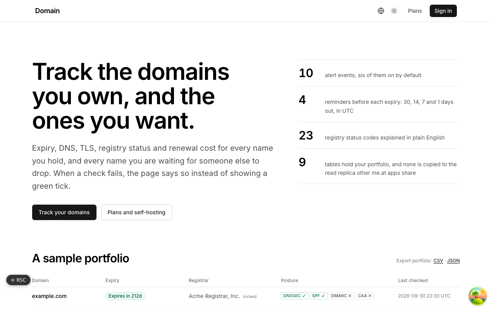

  <picture>
    <source media="(prefers-color-scheme: dark)" srcset=".github/assets/hero-dark.png">
    
  </picture>

# domain.me.at

Track the domains you own, and the ones you want.

domain.me.at is a domain-portfolio tracker: expiry, DNS, TLS, registry status, and renewal cost for every name you hold, and every name you are waiting for someone else to drop. It is for individuals with more domains than they can keep in their head, and for people who look after domains for clients. When a check fails, the page says so instead of showing a green tick.

## Features

- **Expiry reminders**: reminders at 30, 14, 7, and 1 days before each expiry, based on the date the registry reports and calculated in UTC.
- **Registration data**: expiry, registrar, and registry status codes from RDAP with WHOIS as the fallback, and 23 status codes explained in plain English.
- **DNS and mail posture**: nameservers, A/AAAA/MX/TXT/CAA record sets, and whether DNSSEC, SPF, DMARC, and CAA are set, per domain.
- **Certificates**: TLS certificate expiry, issuer, and SANs, with rotations recorded as changes.
- **Honest change feed**: only changes that were actually observed are reported, and a failed check never turns a stale reading green.
- **Alerts**: 10 alert events (six on by default) delivered by email or webhook, with every channel verified before it receives anything.
- **Cost and renewal calendar**: renewal and purchase prices totalled per currency, plus a ninety-day renewal calendar.
- **Export and self-hosting**: CSV and JSON export that is never put behind a plan, and a self-hosted mode with swappable RDAP, WHOIS, and DNS-over-HTTPS clients and an offline license check.

## Built with

- Next.js 16 (App Router), React 19, TypeScript
- Tailwind CSS 4
- Drizzle ORM + Postgres
- RDAP, WHOIS, and DNS-over-HTTPS lookups
- Better Auth (GitHub and Google sign-in)

## Part of the me.at family

domain.me.at is one of the [`*.me.at`](https://me.at) apps by Trevor McDougald. They share one design system, account, and app shell. Development happens in a private monorepo; this repository is the project's public-facing home.

## Acknowledgements

Deliberately modelled on [Lissy93/domain-locker](https://github.com/Lissy93/domain-locker) by Alicia Sykes.

## License

See [LICENSE](LICENSE).
