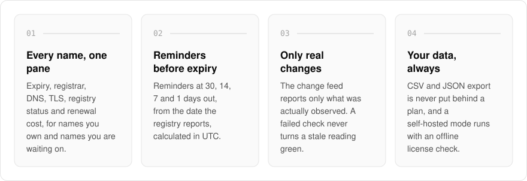
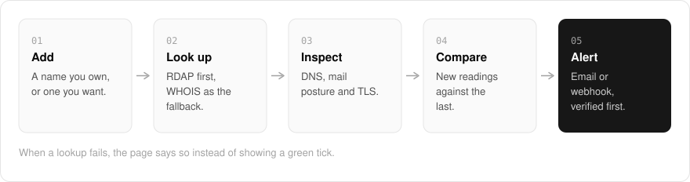

  <picture>
    <source media="(prefers-color-scheme: dark)" srcset=".github/assets/hero-dark.png">
    
  </picture>

<h1 align="center">domain.me.at</h1>

<strong>Track the domains you own, and the ones you want.</strong>

  
  
  
  

  <a href="https://domain.me.at">Website</a> ·
  <a href="#features">Features</a> ·
  <a href="#how-it-works">How it works</a> ·
  <a href="#screenshots">Screenshots</a> ·
  <a href="#built-with">Built with</a>

Once you hold more domains than you can keep in your head, one of them expires at the worst moment. I built domain.me.at as a domain-portfolio tracker: expiry, DNS, TLS, registry status and renewal cost for every name you hold, and every name you are waiting for someone else to drop. It is for individuals with a lot of names and for people who look after domains for clients. When a check fails, the page says so instead of showing a green tick.

  <picture>
    <source media="(prefers-color-scheme: dark)" srcset=".github/assets/overview-dark.svg">
    
  </picture>

## Why domain.me.at

| The usual registrar dashboard | domain.me.at |
| --- | --- |
| Only the names held at that registrar | Every name you own, plus the ones you are waiting on |
| A single renewal email, easy to miss | Reminders at 30, 14, 7 and 1 days before expiry |
| Raw registry status codes | 23 status codes explained in plain English |
| A green tick, even when the lookup failed | A failed check never turns a stale reading green |

## Features

- **Expiry reminders**: reminders at 30, 14, 7 and 1 days before each expiry, based on the date the registry reports and calculated in UTC.
- **Registration data**: expiry, registrar and registry status codes from RDAP with WHOIS as the fallback, and 23 status codes explained in plain English.
- **DNS and mail posture**: nameservers, A/AAAA/MX/TXT/CAA record sets, and whether DNSSEC, SPF, DMARC and CAA are set, per domain.
- **Certificates**: TLS certificate expiry, issuer and SANs, with rotations recorded as changes.
- **Honest change feed**: only changes that were actually observed are reported, and a failed check never turns a stale reading green.
- **Alerts**: 10 alert events (six on by default) delivered by email or webhook, with every channel verified before it receives anything.
- **Cost and renewal calendar**: renewal and purchase prices totalled per currency, plus a ninety-day renewal calendar.
- **Export and self-hosting**: CSV and JSON export that is never put behind a plan, and a self-hosted mode with swappable RDAP, WHOIS and DNS-over-HTTPS clients and an offline license check.

## How it works

  <picture>
    <source media="(prefers-color-scheme: dark)" srcset=".github/assets/flow-dark.svg">
    
  </picture>

Add a name you own or one you want. Registration data comes from RDAP, with WHOIS as the fallback, and DNS, mail posture and the TLS certificate are read alongside it. Each new reading is compared with the last, only observed changes reach the feed, and alerts go out by email or webhook to channels that were verified first.

## Screenshots

<table>
  <tr>
    <td width="50%"><picture><source media="(prefers-color-scheme: dark)" srcset=".github/assets/hero-dark.png"></picture> The landing page: what domain.me.at tracks for every name.</td>
    <td width="50%"><picture><source media="(prefers-color-scheme: dark)" srcset=".github/assets/pricing-dark.png"></picture> Plans: the hosted and self-hosted channels, and exactly what a license key does today. No prices are published yet.</td>
  </tr>
</table>

## Built with

  
  
  
  
  

- Next.js 16 (App Router), React 19, TypeScript
- Tailwind CSS 4
- Drizzle ORM + Postgres
- RDAP, WHOIS and DNS-over-HTTPS lookups
- Better Auth (GitHub and Google sign-in)

## Part of the me.at family

domain.me.at is one of my [`*.me.at`](https://me.at) apps. They share one design system, one account, and one app shell. Development happens in a private monorepo; this repository is the project's public-facing home.

## Acknowledgements

Deliberately modelled on [Lissy93/domain-locker](https://github.com/Lissy93/domain-locker) by Alicia Sykes.

## License

Source-available. See [LICENSE](LICENSE).
